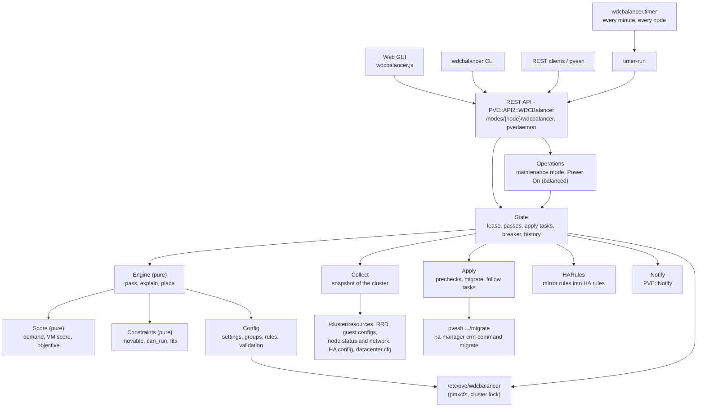
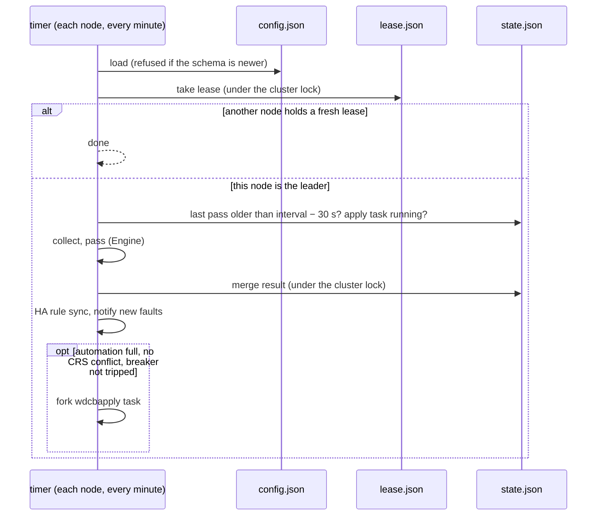

# pve-wdcbalancer: How It Works

Version 0.4.0

## Goals and the DRS mapping

wdcbalancer rebuilds vSphere DRS on parts Proxmox VE already has: the RRD usage data `pvestatd` writes every minute, pmxcfs for cluster-wide state and locking, the migrate API for moves, and the HA manager for HA guests. It adds no daemon, no kernel code and no changes to how guests run. If you remove it, the cluster is exactly as it was, apart from the HA rules it mirrored (which are marked).

**Goals, in priority order**

1. Never make a move that breaks a guest. A guest is only recommended where it can actually run (storage, network, CPU, memory, rules), and every move is checked again on live data just before it starts.
2. Never fight another scheduler, or itself. One node plans at a time, an apply runs alone, HA guests move through HA, and nothing moves while Proxmox CRS rebalances.
3. Be calm. A balancer that moves guests because of load noise costs more than it gains. Moves have a cost, going back is expensive, and small imbalances are tolerated.
4. Match the vSphere operator experience: the same automation levels, migration threshold, scores, rules, maintenance mode and recommendations.
5. Keep GUI, CLI and API identical, by building the CLI and GUI on the API.

| vSphere DRS | wdcbalancer | Difference |
| --- | --- | --- |
| DRS cluster | The Proxmox VE cluster | One configuration per cluster, in `/etc/pve/wdcbalancer/config.json` |
| DRS runs in vCenter | The lease holder among the nodes runs the passes | No central server; any node takes over within 3 minutes |
| Every 5 minutes, plus on events | Every `interval` (default 300 s), plus **Run now** | No event-driven passes (yet) |
| VM DRS score (vSphere 7) | VM score: share of demand served, 0–100 % | Contention from node utilization and PSI instead of ready time and swap counters |
| CPU ready time | CPU pressure (PSI "some") raises CPU demand | Same idea: time spent waiting for a CPU is demand not served |
| Active memory, idle consumed share 25 % | `memory_metric=active`: used + 25 % of the rest the host holds | Same default share |
| Ballooning, swapping | Memory pressure (PSI "full") raises memory demand | |
| Migration threshold 1–5 | `threshold` 1–5, priority from net gain in score points | Priority thresholds are fixed per level |
| Target imbalance | Tolerated imbalance per threshold | |
| vMotion cost-benefit | Fixed cost per move, migration time cost, bounce cost | |
| VM/Host rules, VM-VM rules | Rules with the same types and modes | Rules can also be mirrored into native HA rules |
| DRS faults | Faults | |
| Maintenance mode | Maintenance mode, with HA node maintenance for HA guests | |
| Initial placement | Power On (balanced) | Proxmox's Start button isn't intercepted |
| EVC | Guests with `cpu: host`/`max` only move between identical CPUs | No CPU masking; choose a common CPU model |
| DPM, resource pools, reservations, shares | Not implemented | |

## Architecture



| Component | File | Role |
| --- | --- | --- |
| Config | `PVE/WDCBalancer/Config.pm` | The cluster configuration: schema, defaults, validation, rule conflicts, locked read-modify-write |
| Collect | `PVE/WDCBalancer/Collect.pm` | Builds the snapshot a pass works on |
| Score | `PVE/WDCBalancer/Score.pm` | Demand model, VM score, cluster score, imbalance, objective (pure) |
| Constraints | `PVE/WDCBalancer/Constraints.pm` | Where a guest may run (pure) |
| Engine | `PVE/WDCBalancer/Engine.pm` | One pass, explain, initial placement (pure) |
| Apply | `PVE/WDCBalancer/Apply.pm` | Runs moves: order, concurrency, prechecks, the migration commands, completion |
| State | `PVE/WDCBalancer/State.pm` | Lease, passes, the timer job, apply tasks with heartbeat, circuit breaker, history |
| HARules | `PVE/WDCBalancer/HARules.pm` | Mirrors rules into native HA rules |
| Operations | `PVE/WDCBalancer/Operations.pm` | Maintenance mode and Power On (balanced) |
| Notify | `PVE/WDCBalancer/Notify.pm` | Notifications and what makes a fault new |
| REST API | `PVE/API2/WDCBalancer.pm` | Registered as `/nodes/{node}/wdcbalancer` by one marked line in `PVE/API2/Nodes.pm` |
| CLI | `PVE/CLI/wdcbalancer.pm`, `/usr/sbin/wdcbalancer` | `PVE::CLIHandler`: each command maps onto an API method |
| GUI | `/usr/share/pve-manager/js/wdcbalancer.js` | One `<script>` line in `index.html.tpl`; an Ext `override` of `PVE.panel.Config` adds Datacenter → Load Balancing (after HA) and Node → Load Balancing |
| Integration | `/usr/share/pve-wdcbalancer/wdcbalancer-integrate` | Run by `postinst`, re-run by a dpkg trigger when pve-manager replaces either file |
| Timer | `wdcbalancer.timer`, `wdcbalancer.service` | `wdcbalancer timer-run` every minute on every node |

**Pure core, thin edges.** `Score`, `Constraints` and `Engine` take plain hashes (a snapshot and a config) and return plain hashes. They never call Proxmox, so the tests can feed them any cluster, including thousands of random ones. Everything that talks to the cluster (`Collect`, `Apply`, `State`, `HARules`, `Operations`) is a thin layer around them.

**Every node answers.** The configuration and the last pass are on pmxcfs, so the API gives the same answer on every node. The GUI and CLI simply call the node they are connected to.

## Data model

All files are JSON on pmxcfs in `/etc/pve/wdcbalancer/`, so they are replicated to every node and survive the loss of any node.

**`config.json`**: written only under the cluster lock, and validated before every write.

```json
{
  "version": 1,
  "settings": { "automation": "full", "threshold": 3 },
  "vm_groups": { "web": { "members": [101, 102, 103], "comment": "" } },
  "host_groups": { "rack-a": { "members": ["pve1", "pve2"] } },
  "rules": {
    "web-apart": { "type": "separate", "vms": [101, 102, 103], "enabled": 1 },
    "web-on-a": { "type": "vm-host", "vm_group": "web", "host_group": "rack-a", "mode": "should", "enabled": 1 }
  },
  "overrides": { "104": { "automation": "disabled" } },
  "maintenance": { "pve3": { "since": 1793600000, "user": "root@pam", "move_stopped": 0, "ha": 1 } }
}
```

Only settings that differ from the defaults are stored. `version` is the schema version (see Upgrade in the runbook): `migrate()` upgrades older schemas step by step through `%UPGRADE`, and refuses a newer one.

**`state.json`**: the last pass and the shared run-time state, changed only by `update_state()`.

| Key | Content | Written by |
| --- | --- | --- |
| `time`, `node`, `duration`, `trigger` | When and where the last pass ran, and why | pass |
| `result` | The pass result: recommendations, faults, guests, nodes, cluster | pass; apply removes applied recommendations; dismiss removes one |
| `dismissed` | `{ rec-id: time }`, for an hour | dismiss, pass (expiry) |
| `moved` | `{ vmid: time }` of the last successful move, for the cooldown (kept 24 h) | apply |
| `left` | `{ vmid: { node, time } }`: the node a guest last left, for the bounce cost (kept 24 h) | apply |
| `applying` | `{ node, pid, time, beat, count }` of the running apply task | apply (start, heartbeat, end) |
| `failures`, `breaker` | The circuit breaker's counters and, when tripped, `{ time, reason }` | apply, resume |
| `members`, `members_changed` | The set of online nodes and when it last changed | pass |

If `state.json` would grow over 900 KiB, the per-guest details of the pass are dropped (`result.truncated`); pmxcfs files must stay small.

**`history.json`**: a list of events (passes, moves, dismissals, HA rule changes, maintenance, power-on, breaker, resume), capped at 500 events and 512 KiB. Long texts are cut at 1000 characters and lists at 50 entries.

**`lease.json`**: `{ node, time }` of the node that runs the timer passes.

**`nodefacts.json`**: each node's CPU model, sorted CPU flags and bridges, refreshed when older than 15 minutes.

**A recommendation**

```json
{ "id": "101:pve1:pve2", "vmid": 101, "name": "web1", "type": "qemu", "from": "pve1", "to": "pve2",
  "priority": 3, "kind": "balance", "reason": "Balance average CPU load", "gain": 24.6,
  "mem": 4294967296, "ha": 0, "restart": 0 }
```

`mem` is the guest's memory footprint, checked against the target's free memory just before the move. `rule` names the rule a fix is for.

## The pass, step by step

### 1. Collect

`Collect::snapshot` builds a plain hash of the cluster, on whichever node runs the pass:

- **One parallel batch of API calls** (`pvesh get`, 60 s timeout each): `/cluster/resources`, `/cluster/sdn/vnets`, and for each online node whose cached facts are stale, `/nodes/X/status` (CPU model and flags) and `/nodes/X/network --type any_bridge` (bridges). Starting `pvesh` takes a second or two, so running them in parallel keeps a pass to a few seconds on a large cluster.
- **Usage**: every node's and running guest's RRD data (`pve-node-9.0/X`, `pve-vm-9.0/ID`), the `hour` timeframe at 1-minute resolution, averaged over the last `interval` seconds. The number of samples is kept, to notice missing data.
  - Node: CPU (fraction × cores), used memory **minus the ZFS ARC** (reclaimable), network in and out, CPU pressure (some) and memory pressure (full).
  - Guest: CPU (fraction × its cores), memory the guest reports as used (`mem`), memory the host holds for it (`memhost`), network, CPU and memory pressure.
- **Node overhead**: what the node uses that its running guests don't explain (services, Ceph OSDs, …), for CPU and memory. It stays on the node whatever moves.
- **Guest configs** from `/etc/pve/nodes/*/{qemu-server,lxc}/*.conf` (only the current section, not snapshots): disks and their storages (unused disks ignored, CD-ROMs with `none` ignored, a host CD-ROM drive counts as a host device), passthrough (`hostpci*`, `usb*` except SPICE, raw `lxc.mount.entry`), bridges, CPU type, lock, template flag.
- **Storages**: shared or not, and on which nodes each is available.
- **HA**: the enabled rules in `/etc/pve/ha/rules.cfg`, the nodes in HA maintenance (`manager_status`), and which guests are HA resources.
- **CRS**: `datacenter.cfg` `crs:`, to notice `ha-auto-rebalance`.
- **Quorum** (`check_cfs_quorum`), and **maintenance** marks from the config.

### 2. Demand

For each running guest (`Score::guest_demand`):

```text
cpu demand = cores used × (1 + CPU pressure some / 100)
mem demand = active:   used + 0.25 × max(0, host − used)        then × (1 + memory pressure full / 100)
             consumed: host
net demand = bytes/s in + out
```

A node's **load** is its overhead plus the demand of the guests placed on it; its **utilization** is load ÷ capacity (cores, memory, `net_capacity`). The pass works on a *placement* (`{ vmid: node }`), so it can evaluate any hypothetical arrangement without touching the cluster.

### 3. Scores

Each resource has an efficiency curve: the share of demand a node serves at a given utilization.

| | 1.0 up to | then, to 100 % | above 100 % |
| --- | --- | --- | --- |
| CPU | 80 % | 1 − 0.5 × (u − 0.8), 0.9 at 100 % | 0.9 / u |
| Memory | 90 % | 1 − 3 × (u − 0.9), 0.7 at 100 % | 0.7 / u |
| Network (network-aware) | `net_threshold` | down to 0.5 at 100 % | 0.5 / u |

Memory falls off much faster than CPU, because a host short of memory reclaims, compresses or swaps, which hurts every guest on it.

A guest's **VM score** is `100 × min(cpu, mem, net)` at its node's utilization. CPU contention is weighted by how much CPU the guest uses: below 0.1 core it fades out (an idle guest barely notices a busy CPU). Network works the same below 1 MB/s.

The **cluster score** is the average VM score; the **buckets** count guests per 20 % band. **Imbalance** is `sqrt((σ_cpu² + σ_mem²) / 2)`, the standard deviations of node utilization over the online nodes not in maintenance.

Worked example: a 32-core node with 30 cores of demand runs at 94 %. Its CPU efficiency is `1 − 0.5 × 0.1375 = 0.93`, so a busy guest there scores 93. At 120 % it would score `0.9 / 1.2 = 75`.

### 4. Objective, gain, cost, priority

The pass maximizes an **objective** in VM-score points:

```text
objective = Σ VM scores − 200 × spread
spread    = ½ × Σ over active nodes and (cpu, mem) of (utilization − cluster mean)²
```

The spread term makes evening out load worth something even when every guest scores 100. Moving load δ from a node at utilization a to one at b lowers the spread by about δ(a − b) − δ², whatever the size of the cluster: moving a tenth of a node's capacity from a node at 90 % to one at 30 % is worth `200 × (0.1 × 0.6 − 0.01) = 10` points.

`Score::objective_after` computes the objective after a move incrementally: only the guests on the source and the target change score, so evaluating every guest × every node stays cheap.

A move's **net gain** is its change in the objective minus its **cost**:

```text
cost   = 3 points per guest moved + 2 points per minute of migration (footprint ÷ migration_speed)
bounce = 25 points per guest moved back to the node it left less than 4 hours ago
```

The fixed part stops load noise from justifying moves: without it, a few percent of random variation produces a stream of moves that each look slightly positive. The bounce cost stops A → B → A churn unless the load really changed.

| Net gain | Priority |
| --- | --- |
| mandatory | 1 |
| ≥ 50 | 2 |
| ≥ 20 | 3 |
| ≥ 8 | 4 |
| ≥ 2 | 5 |

A recommendation is made when its priority ≤ the threshold. Because the gain is a sum over all guests, a move that relieves a contended node counts for every guest on it, so gains don't shrink as the cluster grows.

### 5. Holds

Before recommending anything, the pass checks whether its data and the cluster can be trusted (each hold is a fault):

| Condition | What is still recommended | Why |
| --- | --- | --- |
| No quorum | nothing | pmxcfs is read-only, and the cluster may be partitioned |
| The online-node set changed less than 10 minutes ago (`State::members_key`) | mandatory moves | HA is recovering guests and the load is moving by itself |
| An online node has no RRD samples in the window | mandatory moves | The balancer would see it as empty |
| More than 25 % of running guests have no samples | mandatory moves | The picture is too incomplete |

A guest without samples is never moved for balancing.

### 6. Mandatory moves (priority 1, every threshold)

In this order:
1. **Maintenance**: every running guest on a node in maintenance mode (ours or HA's), with its keep-together partners on that node as one unit.
2. **must / must-not rules**: `Config::must_nodes` intersects all of a guest's hard VM/Host rules into the set of allowed nodes; a guest outside it moves in.
3. **separate rules**: on a node with two or more members, the one with the largest memory footprint stays (the costliest to move) and the others move.
4. **keep together rules**: rules that share a guest are joined into **units** by union-find (`Engine::together_units`). A split unit gathers on the node where it does best: fewest *should* rule violations first, then the best net gain after the cost of the moves, then the fewest moves. Gathering on the node that already holds most of them would often just be balanced away by the next pass.

Each move goes to the best valid target (`$best_target`): allowed by the constraints, by separate rules (also among the guests moving together) and by keep-together partners elsewhere, with the memory, soft rules first, then the objective. A move that can't be made (the guest isn't movable, no node fits) becomes a fault instead.

### 7. Soft rule fixes (priority 2, threshold ≥ 2)

Guests that violate a *should* or *should-not* rule move, as a unit, to the best node that meets all their soft rules. A unit with a member already moved in this pass waits for the next pass (one move per guest).

### 8. Balancing (threshold ≥ 2)

A greedy loop, up to `max_moves` successful moves (and at most 4 × `max_moves` steps):

1. **Tolerance check.** If the imbalance is within the threshold's tolerance (0.20, 0.15, 0.10, 0.07 for thresholds 2–5): stop when every guest scores ≥ 95; otherwise only priority 2 moves count in this step.
2. **Candidates**: every unit (a guest, or a keep-together unit on one node) that is movable, has usage data, isn't in its cooldown and wasn't moved by an earlier step of this pass.
3. For each candidate and each node: skip nodes where the move would be invalid, would violate a soft rule, or was dismissed in the last hour; compute the net gain (with the cost and the bounce cost).
4. Take the best one. Stop if its priority is above the limit.
5. Record it and re-evaluate the placement.

**Re-targeting.** A unit balanced earlier in the same pass may be picked again. Instead of a second migration, its recommendation gets the new target (no new cost); if the best place is back where it started, the recommendation is removed and its cost refunded. A re-targeted recommendation moves to the end of the list, because it was planned on the state after the others.

**One recommendation per guest.** The same rule holds for all steps: `$record` re-targets an existing recommendation of the guest (keeping the higher priority), or drops it when the guest would end where it started. So the list never asks for two migrations of one guest.

### 9. Report

The pass returns the recommendations in order, the faults, every guest (score now, expected score after the recommendations, demand, automation level, movable or why not), every node (utilization now and after) and the cluster summary (scores, buckets, imbalance before and after, hold, quorum). Without quorum, the recommendations are cleared and the "after" values equal the current ones.

### Constraints

`Constraints::movable` (no target involved): a guest can't move if it is a template, not running, locked, has the override `disabled`, has a disk on local or unknown storage or a host device/path as disk, or has passthrough.

`Constraints::can_run` (per target): the target must be online and not in maintenance; allowed by the guest's *must* rules and by strict native HA node-affinity rules; have every storage of the guest available and every bridge (or the bridge is an SDN vnet); and for `cpu: host`/`max`, the same CPU model and flags as the source.

`Constraints::fits`: the target's memory footprint (overhead plus `max(memhost, mem)` of its guests) plus the guest's must stay under `maxmem × (1 − headroom)`. The footprint, not the demand, is what a live migration needs on the target.

### Explain and initial placement

`Engine::explain` evaluates one guest against every node: allowed or why not, the VM score it would get, and the gain.

`Engine::place` (Power On (balanced)) treats a stopped guest as if it ran with a quarter of its cores and all of its memory, ranks every node (constraints, memory, separate rules against running members, keep-together partners, then fewest soft rule violations, then the best objective, preferring its current node on a tie) and places guests one after the other, each counting for the next.

## Running passes: timer, lease, locking



**Lease.** `take_lease` writes `{ node, time }` to `lease.json` under the cluster lock. A lease not renewed for 180 s is taken over by the next node whose timer fires. An apply task started by automation renews the lease while it runs, so a long apply doesn't hand the passes to another node. The config is loaded *before* taking the lease: a node that can't read it (an older version during an upgrade) never becomes leader.

**One lock.** Every write to `config.json` and `state.json` happens inside `cfs_lock_domain('wdcbalancer', 30 s)`, as a read-modify-write: `Config::update` and `State::update_state`. A pass, an apply task and a dismissal can run at the same time on different nodes; none of them may undo the others' changes. The long parts (collecting, planning, migrating) run outside the lock.

**Merging a pass.** `run_pass` plans outside the lock, then merges under it:
- recommendations for guests that were moved while the pass ran are dropped (they are stale);
- dismissals from both sides are kept;
- the apply task's marker, moves, breaker and other keys written meanwhile stay; only the pass's own keys are replaced.

**Interval.** The leader runs a pass when the last one is at least `interval − 30 s` old (timer jitter). **Run now** runs one at once, wherever it is called, without the lease.

## Applying moves

`State::apply` runs inside a task (`wdcbapply`):

1. Under the lock: refuse if another apply runs (`apply_running`) or, for automation, if the breaker is tripped; write the `applying` marker with node, pid, time and heartbeat.
2. `Apply::run` executes the moves:
   - **Order and concurrency** (`next_batch`, pure): in list order, a move starts when neither its source nor its target already has `max_concurrent` moves, and the guest has no move running.
   - **Precheck** on live data, just before each start: the guest is still on its source (`get_vmlist`), the target is online, the guest isn't locked, the cluster is quorate, the target isn't in maintenance mode (re-read from the config), and a running guest's footprint fits in the target's `memory.available` now (`/nodes/X/status`). A failed precheck is a "skipped:" result.
   - **Command**: VMs `pvesh create /nodes/<from>/qemu/<id>/migrate --target <to> --online 1`; containers `… /lxc/<id>/migrate --target <to> --restart 1`; stopped guests (maintenance, power-on) without either flag; HA guests `ha-manager crm-command migrate vm:<id> <to>`. Each runs as a child process with its output captured.
   - **Completion**: every 3 s, a move is done when the guest's config is on the target. A non-zero exit fails it with the last error line; a migration task that stopped with an error fails it; a task that ended OK but left the guest elsewhere for 30 s fails it; 4 hours without arrival times it out. HA moves only queue a request, so for them only arrival (or the timeout) counts.
   - **Heartbeat** every 60 s: the marker's `beat` is renewed (and, for automation, the lease).
3. Under the lock: remove the marker, record `moved` and `left` for successful moves, remove applied recommendations, update the circuit breaker, add the history events.
4. Notify: every automatic apply, and manual applies with failures; the breaker if it tripped. The task fails if any move failed.

**Stale tasks.** `apply_running` treats the marker as not running when its heartbeat is over 10 minutes old, the task started over 4 h 10 min ago, its process is gone (same node, `kill 0`), or its node is offline in the corosync membership. A node that dies mid-apply therefore blocks passes for at most 10 minutes.

**Circuit breaker.** `breaker_update` keeps a streak of consecutive failed moves and the times of failures in the last hour; "skipped:" results don't count, a success resets the streak. 3 in a row or 5 within an hour trips it. While tripped, the timer doesn't start automatic applies and `State::apply` refuses automation; manual applies still work. `resume` clears it.

## Maintenance mode and power-on

`Operations::enter_maintenance` (task `wdcbmaint`):
1. Writes the maintenance mark into the config (who, when, `move_stopped`, whether HA guests were there).
2. With HA guests on the node: `ha-manager crm-command node-maintenance enable <node>`.
3. Up to 5 rounds: run a pass, take its `maintenance` recommendations for non-HA guests on this node not tried yet, apply them. A running apply task makes it wait and retry.
4. Waits up to an hour for HA to move its guests.
5. With `move-stopped`: places the stopped guests with `Engine::place` (the node excluded) and moves them offline.
6. Reports the guests still running there and why, and fails if any remain. The mark stays.

`exit_maintenance` removes the mark and, if entering turned it on, HA node maintenance.

`Operations::power_on` (task `wdcbpoweron`) gets a placement for the guests, honours a `target` for a single guest only if that node is allowed, then per guest: HA guests `ha-manager set <sid> --state started`; others an offline move if needed, then `pvesh create /nodes/<to>/<type>/<id>/status/start`.

## HA rule mirroring

`HARules::desired` builds the HA rules the config implies, only for guests in `/etc/pve/ha/resources.cfg`:

| Rule | HA rule (`wdcb-<name>`, comment `managed by pve-wdcbalancer`) |
| --- | --- |
| vm-host must / should | node-affinity, positive, strict 1 / 0, nodes = the host group |
| vm-host must-not / should-not | node-affinity, negative, strict 1 / 0 |
| together / separate | resource-affinity, positive / negative, with at least two HA guests |

`HARules::plan` (pure) compares them with the existing rules and returns operations:
- **create** when it doesn't exist;
- **conflict** when a rule with that ID exists without our comment (never touched, reported as a fault);
- **update** when ours differs or is disabled; **delete + create** when the type changed (it can't change in place);
- **delete** for rules with our prefix *and* comment that are no longer wanted.

`sync` applies them through `pvesh` on `/cluster/ha/rules`. It runs after every rule or group change, on every timer pass, and on `ha-sync`. A test runs `plan` over 500 random sets of wanted and existing rules, mixing ours, hand-made ones with our prefix, hand-made ones with our comment and plain hand-made ones, and checks that only rules with both our prefix and our comment are ever changed or deleted.

## Notifications

`Notify::send` calls `PVE::Notify::notify` with the template `wdcbalancer-alert` and the metadata `type=wdcbalancer`, `hostname=<node>`. A failure to notify is logged and never fails the pass or the task.

`new_faults` compares the faults of this pass with the last one by `fault_key`: type, rule and guests, or for faults without guests the type, rule and message with every number replaced by `#`. So "waiting 7 more minutes" and "waiting 6 more minutes" are the same fault. Faults of type `data` and `hold` are never sent: they pass by themselves.

## Integration with Proxmox VE

**API.** pve-manager has no plugin hook for API paths, so `wdcbalancer-integrate apply` adds one marked line to `PVE/API2/Nodes.pm` that registers `PVE::API2::WDCBalancer` under `/nodes/{node}/wdcbalancer`, inside an `eval` that only warns if the module fails to load. The edited file is compile-checked (`perl -c`) and rolled back on failure. The line goes after pve-fcsan's line if that package is installed, so re-applying either never moves the other's.

**GUI.** One marked `<script>` line in `index.html.tpl` loads `wdcbalancer.js`. It defines an Ext `override` of `PVE.panel.Config` that, for `PVE.dc.Config`, inserts **Load Balancing** after the HA entries and, for `PVE.node.Config`, adds it to the node menu, both only for users with `Sys.Audit`. The override is wrapped in `try`/`catch` and always calls the parent, so a GUI error only loses the entry. Every grid column goes through `safeColumns` (HTML-encoded), and the GUI never migrates guests itself: moves only go through the apply API, with its permission checks, limits and history.

**dpkg trigger.** `debian/triggers` registers interest in both files. When a pve-manager update replaces them, the trigger re-runs `apply` and reloads `pveproxy`, `pvedaemon` and `pvestatd`.

**API methods** run in pvedaemon as root (`protected`), because they read RRD files and write pmxcfs; the permission checks are done before. Long operations are tasks (`fork_worker`), so they show in the task list with a log and survive the browser closing.

## Safety, failure modes, permissions

| What happens | What the balancer does |
| --- | --- |
| The leader node dies | Its lease expires after 180 s; another node runs the passes |
| A node dies during an apply | Moves to or from it fail and are reported; the others finish. If it ran the task, the marker goes stale within 10 minutes |
| A node goes down or comes back | 10 minutes of hold (only mandatory moves), so HA recovery and the load settle first |
| Quorum is lost | No recommendations, Apply refused, every pending move skipped at its precheck |
| Usage data is missing | Hold (only mandatory moves); guests without data are never balanced |
| Memory on the target filled up since the pass | The move is skipped at its precheck |
| A guest got locked (backup) or was moved meanwhile | Skipped at its precheck |
| Moves keep failing | The circuit breaker pauses automation and notifies |
| Load is noisy | Fixed move cost, tolerance, cooldown, bounce cost |
| Two passes run at once (timer and Run now) | Both merge under the lock; neither erases the apply marker or dismissals |
| A node runs an older version | It refuses a newer config and doesn't take the lease |
| Proxmox CRS rebalances too | No moves at all until it is turned off |
| pve-manager is upgraded | The dpkg trigger re-applies the integration |
| The balancer module fails to load | Only its API path is missing; the Proxmox API keeps working |
| A hand-made HA rule has a mirrored name | Never touched; a fault reports it |

Permissions: viewing needs `Sys.Audit` on `/`; any change `Sys.Modify` on `/`; applying also `VM.Migrate` on each moved guest; maintenance mode `VM.Migrate` on `/vms`; Power On (balanced) `VM.PowerMgmt` and `VM.Migrate` on each guest. Automatic applies run as `root@pam`, and are limited by the automation level, the overrides and the threshold.

## Development and testing

**Design decisions**

| Decision | Chosen | Rejected, and why |
| --- | --- | --- |
| Scheduler | Our own, for every guest; HA guests move through HA | Native CRS: only HA guests, one move per round, no rules for non-HA guests, no recommendations |
| Where it runs | A timer on every node, one lease holder | A daemon: another service to supervise; a single fixed node: a single point of failure |
| State | JSON on pmxcfs, one cluster lock | A database: another dependency, not replicated |
| Usage data | The RRD files `pvestatd` already writes | Our own sampling: more load, another daemon |
| Contention signal | Node utilization curves plus PSI | Guest-internal counters: need an agent in every guest |
| Planning | Greedy, one move at a time, re-evaluated after each | Global optimization: hard to explain, unstable from pass to pass |
| Moves | `pvesh …/migrate` and `ha-manager crm-command migrate` | Calling qemu-server directly: bypasses tasks and permissions |
| API exposure | One line in `Nodes.pm`, re-applied by a dpkg trigger | A separate daemon and port: a second auth path |
| GUI | Ext `override` of `PVE.panel.Config` | Patching `pvemanagerlib.js`: replaced on every update |
| Power-on placement | A separate Power On (balanced) action | Intercepting Start: needs patching qemu-server |

**Tests** (`make test`, 482 checks; PVE modules are stubbed when not installed, so they run anywhere with Perl):

| File | Covers |
| --- | --- |
| `t/20-collect.t` | Guest config parsing (disks, EFI and mount points, CD-ROMs and ISOs, unused disks, passthrough and SPICE, bridges, CPU type, locks, raw LXC mounts, snapshot sections ignored), HA rules parsing, RRD averaging over the window, settings defaults and overrides |
| `t/30-engine.t` | Scores and demand, every pass step, priorities and thresholds, every rule type, maintenance evacuation, cooldown, dismissals, holds, move and bounce costs, tolerance, explain, initial placement |
| `t/35-engine-properties.t` | 300 random clusters with random rules (`WDCB_SEEDS` for more; 20,000 were run once): every recommendation is a move the constraints allow from where the guest is at that point, never two for one guest, balancing improves the objective and keeps soft rules, and a pass that stopped on its own is a fixed point |
| `t/36-simulate.t` | 160 passes in a row with every recommendation applied, ±15 % load noise and a load shift at pass 100, for thresholds 2–5 and three seeds: the cluster settles, no guest bounces back within 4 hours, few moves on noise, quick recovery after the shift |
| `t/40-rules.t` | Config validation and rule conflict detection (including transitive keep-together/separate conflicts), and how the engine fixes each rule type: must, must-not, separate (the largest stays), together, unmovable guests as faults, balancing never breaking a rule |
| `t/50-state.t` | Lease, pass merging, concurrent passes and applies, stale apply markers, the circuit breaker, settling after node changes, the history cap, the config schema |
| `t/60-apply.t` | Apply order and concurrency, every precheck, the migration commands, completion and failure detection, automation filtering, notification keys, HA rule mirroring safety over 500 random rule sets |
| `t/70-operations.t`, `t/71-operations-flow.t` | Maintenance mode (rounds, HA node maintenance, stopped guests, blocked guests), Power On (balanced) with and without a target |
| `t/80-integrate.t` | `wdcbalancer-integrate` against a fake pve-manager tree: insertion point, a second apply changing nothing, coexistence with pve-fcsan's line in both orders, refusal without the anchor, exact removal, `Nodes.pm` still loading with a broken module |
| `t/85-gui.t` | Static GUI checks: every grid column HTML-safe, every API path the GUI calls exists, the menu hook, the tabs, the GUI never migrates by itself, confirmations for apply and resume |
| `t/90-compile.t` | Every module loads without warnings; with the real PVE libraries, every CLI command maps onto an API method; the API version matches the package |

`t/symbols.pl`, run on a Proxmox host, checks that every `PVE::*::function` the code calls exists in the installed libraries. CI runs the tests, `node --check` on the GUI, `make lint` (shellcheck, perlcritic, and a check that every GitHub Action is pinned to a commit SHA) and builds the package on every push and pull request.

**What the tests found.** The property and simulation tests found real engine bugs that hand-written cases missed: double moves of one guest in a pass, keep-together fixes undone by the next pass, overlapping keep-together rules fixed one at a time, a missed transitive rule conflict, and churn under noisy load (35–83 moves in 6 hours at thresholds 4–5, now 0–1 at thresholds 2–4).

**Validation so far.** The read-only parts run on a 6-node Proxmox VE 9.2 lab cluster: install, integration, timer and lease, collection, scores, recommendations, explain, rules, the GUI, and a live check of the prechecks' data sources. Live moves are next: they need shared storage, and the [1.0 test plan](wdcbalancer-Test-Plan.md) lists every check.

**Release steps**

1. Update `debian/changelog`, `CHANGELOG.md` and the version in the docs.
2. `make test`; CI builds and lints every push.
3. Merge to `main` and create the release `vX.Y.Z`. CI attaches the `.deb`, a `SHA256SUMS` file and a signed build-provenance attestation, and rebuilds the signed apt repository on GitHub Pages from every release's `.deb` (`tools/build-apt-repo.sh`).
4. Roll out node by node, checking `wdcbalancer-integrate status` after each.

## Limitations, known risks, roadmap

**Known risks**

| Risk | Why it might bite | How to check |
| --- | --- | --- |
| No live moves on a real cluster yet | Migration commands, completion detection and HA moves are tested against stubs | Run the 1.0 test plan on a cluster with shared storage before relying on full automation |
| Score curves are a model | The efficiency curves approximate contention; real workloads differ | Compare VM scores with guest performance in your cluster; start at threshold 3 |
| One `net_capacity` for all nodes | Nodes with different NICs are treated the same | Set it to the smallest node's capacity |
| RRD data covers about an hour | An `interval` longer than an hour averages only the last hour | Keep `interval` at an hour or less |
| Widget-toolkit API drift | GUI classes could change in a new Proxmox VE | Open the panel after upgrades; check the browser console |
| `Nodes.pm` anchor text changes | The integration can't find its insertion point | `wdcbalancer-integrate apply` reports it and changes nothing |

**Functional limits compared with vSphere DRS**

- No event-driven passes: a node failure or a power-on doesn't trigger a pass; the next timer pass (or Run now) reacts.
- No DPM, resource pools, reservations, limits or shares.
- No CPU feature masking (EVC); guests with `cpu: host` only move between identical CPUs.
- Power On (balanced) is a separate action; Proxmox's Start starts guests where they are.
- Containers move with a restart.
- Network capacity is one value for the cluster.

**Roadmap**

1. 1.0: run the full test plan on a cluster with shared storage; fix what it finds.
2. Event-driven passes after node failures and HA recovery.
3. Per-node network capacity.
4. Storage DRS for pve-fcsan datastore clusters, using the same recommendation, history and maintenance pattern.
